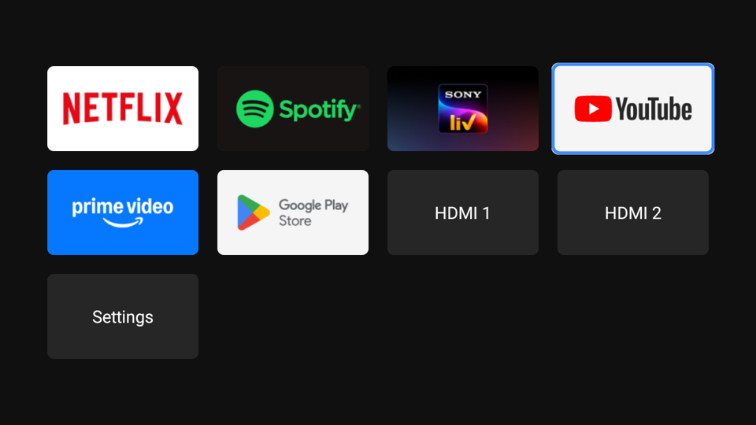

# OnePlus TV minimal

Turning a laggy OnePlus TV Y1S (43Y1S, Android TV 11, 1 GB RAM) into a clean, minimal setup over ADB. No root and no flashing. Every change can be undone.



## Result

| | Before | After |
|---|---|---|
| Packages | 128 | 90 active (31 removed, 8 disabled, 1 added) |
| Home screen | Google TV launcher, 137 MB RAM | Custom launcher, about 20 MB RAM |
| RAM freed | | about 220 MB of 920 MB (per-process estimate) |

Kept working: Chromecast built-in, Play Store and Play Services, Gboard, phone remote service, picture and sound settings, HDMI inputs, USB media, Miracast, Netflix, Spotify, Sony LIV, YouTube and Prime Video.

## What is in here

| Path | What it is |
|---|---|
| `launcher/` | A tiny home screen app (16 KB APK, one Java file, no libraries) |
| `backup/classification.md` | Every package on the TV sorted into keep, safe to remove and risky, with a reason |
| `backup/*.txt` | Package lists and default launcher captured before any change |
| `backup/restore.sh` | Restores every removed or disabled package and the stock launcher |

## The launcher

Tiles for Netflix, Spotify, Sony LIV, YouTube, Prime Video, Play Store, one tile per HDMI port, and Settings. D-pad friendly, so it works from the Google TV phone app. Apps that are not installed open their Play Store page. HDMI tiles are discovered at runtime from `TvInputManager` and open through the TV's Live TV app.

Edit the `APPS` list in `launcher/src/tv/minimal/launcher/MainActivity.java` to change the tiles.

### Build

Needs JDK 17 and the Android SDK (platform 30, build-tools 30.0.3). No Gradle.

```sh
brew install openjdk@17
brew install --cask android-commandlinetools
sdkmanager --sdk_root=/opt/homebrew/share/android-commandlinetools "platforms;android-30" "build-tools;30.0.3"
./launcher/build.sh
```

The first build creates `launcher/release.keystore`. Keep it, because updates must be signed with the same key. It is git-ignored.

### Install and set as home

```sh
adb connect <TV_IP>:5555
adb install -r launcher/build/MinimalLauncher.apk
adb shell pm disable-user --user 0 com.google.android.tvlauncher
```

Android TV gives its own launcher priority, so it has to be disabled. The Settings app keeps a fallback home screen in case the custom launcher ever fails.

## Debloat method

1. Back up first: package lists, settings, and the APKs of every app in `/data` (`adb shell pm path <pkg>` then `adb pull`).
2. Remove in small batches with `adb shell pm uninstall -k --user 0 <pkg>`.
3. Reboot after each batch and check boot, video playback, casting and phone input.
4. Disable instead of removing when a package comes back at boot: `adb shell pm disable-user --user 0 <pkg>`.

See `backup/classification.md` for the exact batches.

## Quirks found on this TV

- `cmd package install-existing` reports success but does not bring back apps that live in `/data`. Reinstall them from the backed-up APKs instead (`restore.sh` does this).
- Apps in `/system/preloadapp` (JioPages, JioGames, Lionsgate Play, User Guide) are reinstalled at every boot. Disable them instead.
- Wait about 45 seconds after `pm disable-user` before rebooting, or the change may not stick.
- ADB cannot disable single components of system apps without root.
- HDMI input is shown by `com.heytap.tv.livetv`. Do not remove it, even without an antenna.
- `adb exec-out screencap` output starts with vendor debug text. Strip everything before the PNG header.
- The OnePlus updater lives inside `com.android.tv.settings` and checks `otag.h2os.com` after each boot. Blocking it needs a router or DNS rule.

## Undo

```sh
./backup/restore.sh
adb reboot
```

`restore.sh` uses the APKs in `backup/apks/`, which are not in this repo. Take your own backup before removing anything.

## Disclaimer

Tested only on a OnePlus TV Y1S 43 running Android TV 11 (build RTM1.210315.027). Other models may differ. Use at your own risk.
